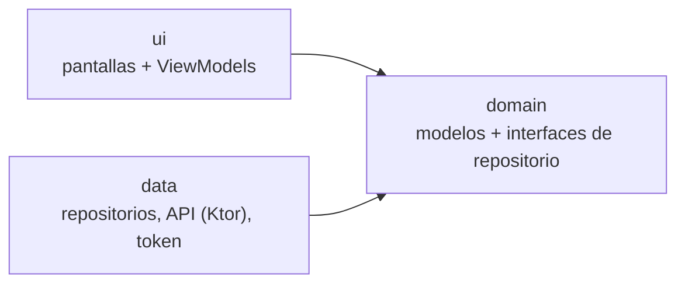

# GestionFacturas — Cliente (Android + Desktop)

> **Proyecto en desarrollo.** Ya están hechos el login y el registro (con renovación
> automática del token), la gestión de clientes y la de gastos; el resto de áreas (ingresos,
> dashboard) aún no.
> Este README describe el diseño acordado y evoluciona con el código.

Cliente de **GestionFacturas**, una aplicación para que **freelances y autónomos** lleven
el control de su actividad económica: registran **gastos**, **ingresos** y **clientes**, y
consultan un panel con su beneficio y la rentabilidad por cliente.

Es una app de **Kotlin Multiplatform con Compose Multiplatform**: una sola interfaz
compartida para **Android y escritorio**. Se desarrolla primero la versión de escritorio y
después se adapta el diseño a móvil.

Principio rector: **organización y visibilidad, nunca asesoría fiscal ni facturación
oficial.**

## Cómo encaja en el proyecto

Este repositorio es **solo el cliente**. Toda la lógica de negocio (beneficio, totales,
transiciones de cobro, control de acceso) vive en el backend:

- **Backend (Spring Boot, arquitectura hexagonal):**
  [GestionFacturas-api](https://github.com/hagi33/GestionFacturas-api)
- **Cliente Android + Desktop (este repo):** consume la API REST con autenticación JWT.
- **Cliente web:** proyecto aparte con Angular, sobre la misma API *(planificado)*.

iOS queda fuera del alcance por no disponer de Mac para compilarlo.

## Stack

| Capa | Tecnología |
|------|-----------|
| Lenguaje y UI | Kotlin Multiplatform + Compose Multiplatform (Material 3) |
| Red | Ktor Client + kotlinx.serialization |
| Asincronía | kotlinx.coroutines |
| Fechas | kotlinx-datetime |
| Inyección de dependencias | Koin |
| Almacenamiento local | Multiplatform Settings (solo la sesión: tokens, id y email) |
| Navegación | Navigation Compose (oficial, multiplataforma; versión 2.10.0-rc01, candidata a estable) |
| Logging | Kermit |
| Build | Gradle (Kotlin DSL) |

## Módulos de Gradle

| Módulo | Contenido |
|--------|-----------|
| `:shared` | Todo el código compartido (datos, dominio, UI). El escritorio es el target `jvmMain` |
| `:androidApp` | Punto de entrada de Android (actividad, manifiesto) |
| `:desktopApp` | Punto de entrada de escritorio (función `main`, empaquetado) |

Las dos apps son finas y solo llaman a `:shared`.

## Arquitectura

**MVVM + Clean Architecture ligera.** Las dependencias apuntan hacia el dominio:



- **ui:** pantallas en Compose y ViewModels. Cada ViewModel expone un único `UiState` y la
  pantalla solo lo pinta. Depende únicamente de `domain`.
- **domain:** Kotlin puro. Modelos e interfaces de repositorio. Los casos de uso solo
  existen cuando una operación orquesta varias fuentes de datos. Por ahora no hay ninguno:
  cerrar sesión vive en `AuthRepository`, que ya dispone de la API remota y del
  almacenamiento local (revoca el token en el backend y borra siempre la sesión local).
- **data:** implementaciones de los repositorios, llamadas a la API, DTOs y
  almacenamiento del token.

Se mantienen separados el DTO de red, el modelo de dominio y el `UiState`, con los mapeos
en la capa de datos. Es la misma idea de inversión de dependencias que usa el backend, pero
con menos ceremonia, porque el cliente no contiene lógica de negocio.

### Estructura de paquetes

Paquete raíz `com.fabio.gestionfacturas`, dentro de `shared/src/commonMain/kotlin/`:

```
├── data/      remote/ (Ktor, DTOs)  ·  local/ (token)  ·  repository/
├── domain/    model/  ·  repository/ (interfaces)  ·  usecase/ (solo si orquesta varias fuentes)
├── ui/        navigation/  ·  login/  clientes/  gastos/  ingresos/  dashboard/  ·  common/
└── di/        módulos de Koin
```

El código específico de plataforma (expect/actual) va en `shared/src/androidMain` y
`shared/src/jvmMain`.

## Decisiones de diseño

| Decisión | Elección | Motivo |
|----------|----------|--------|
| Plataformas | Android + Desktop (web aparte) | Sin Mac no hay iOS; la web con Angular reutiliza una habilidad ya probada |
| Patrón | MVVM con `UiState` único | Estándar, sin librerías extra, fácil de testear |
| Capas | Clean ligera | El cliente no tiene reglas de negocio: los casos de uso serían clases vacías |
| Carpetas | Capas arriba, áreas dentro de `ui/` | Simple, sin repartir cada pantalla en tres sitios |
| Navegación | Navigation Compose oficial | Soporte oficial, se integra con ViewModel y Koin |
| Almacenamiento | Solo el token, sin caché offline | La app es online; se amplía solo si surge la necesidad |

**Importes:** `BigDecimal` no existe en código común de Kotlin Multiplatform, así que los
importes se guardan como **texto** (`Importe`, en `domain/model`), sin ninguna operación
aritmética en el cliente: el backend calcula los totales. `Importe` valida lo que escribe el
usuario (hasta 2 decimales, coma o punto) y la capa de datos lo lee y lo escribe como número JSON,
conservando los ceros finales (`121.00`).

## Estado actual

- [x] Proyecto base generado (Android + Desktop)
- [x] Dependencias base (Ktor, kotlinx.serialization, Multiplatform Settings, Koin, Kermit,
  Navigation Compose)
- [x] Contrato de la API documentado (`docs/api-contract.md`)
- [x] Login y registro (red, almacenamiento de tokens, renovación automática, sesión,
  pantallas y tests unitarios). Pendiente de probar a mano contra el backend real.
- [x] Clientes (estructura con menú lateral, listado, alta, edición y desactivación). Pendiente
  de probar a mano contra el backend real.
- [x] Gastos (listado, detalle, alta, edición y revisión). Pendiente de probar a mano contra el
  backend real. Falta la digitalización de facturas (subida de archivo).
- [ ] Ingresos y cobros
- [ ] Dashboard (resumen, rentabilidad por cliente, pendientes de cobro)
- [ ] Adaptación del diseño a móvil

Se construye por **rebanadas verticales**: cada área se completa de punta a punta (red,
datos, pantalla) antes de empezar la siguiente.

**Limitación conocida (clientes):** si se crea un cliente con un NIF que ya existe, el backend
responde con un conflicto (409), y esto incluye a los clientes desactivados. Como el backend no
tiene un endpoint para reactivar clientes, el NIF de un cliente desactivado no se puede volver a
usar desde la aplicación. El formulario lo avisa; la solución real requiere un cambio en el backend.

## Cómo arrancar (desarrollo)

**Requisitos:** Android Studio (o IntelliJ IDEA) con el plugin de Kotlin Multiplatform, y el
**backend en ejecución** (ver su README: PostgreSQL con Docker y un usuario registrado).

```bash
# Escritorio (el ciclo de desarrollo más rápido)
./gradlew :desktopApp:run

# Tests del código compartido
./gradlew :shared:jvmTest
```

Para Android, ejecuta la configuración de `androidApp` desde el IDE, con un emulador o un
móvil con depuración USB.

**URL del backend según plataforma:**

| Plataforma | URL |
|------------|-----|
| Desktop | `http://localhost:8080` |
| Emulador de Android | `http://10.0.2.2:8080` |
| Móvil físico | IP del PC en la red local |

La URL se define por plataforma en `UrlBase.jvm.kt` y `UrlBase.android.kt` (función
`urlBaseApi()`, dentro de `shared`).

En Android el tráfico HTTP sin cifrar está bloqueado por defecto; en desarrollo se permite
solo en la compilación de depuración y solo para `10.0.2.2` y `localhost`
(`androidApp/src/debug/`). La compilación de release no lo permite.

## Notas de seguridad

- Los tokens se guardan con Multiplatform Settings, que **no cifra**. Es aceptable para este
  proyecto personal; el almacenamiento seguro (por ejemplo, Android Keystore) queda como
  mejora pendiente.
- Autenticación: el token de acceso se renueva solo al recibir un 401 (el backend responde 401,
  no 403, a un token ausente o caducado). El token de refresco no rota. Si la renovación
  falla, se borra la sesión y se vuelve al login. Al cerrar sesión se revoca el token de
  refresco en el backend (si hay red) y siempre se borra la sesión local.
- El cliente nunca registra contraseñas, tokens ni cuerpos de peticiones.
- El backend limita las peticiones (login: 10/min por IP; resto: 50/min por usuario). El
  cliente debe tratar el HTTP 429 con un mensaje claro.

---

*Proyecto personal en desarrollo. La documentación se amplía conforme avanzan las fases.*
